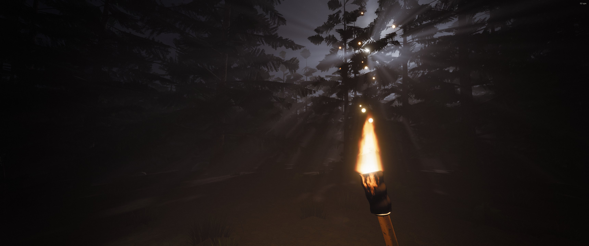
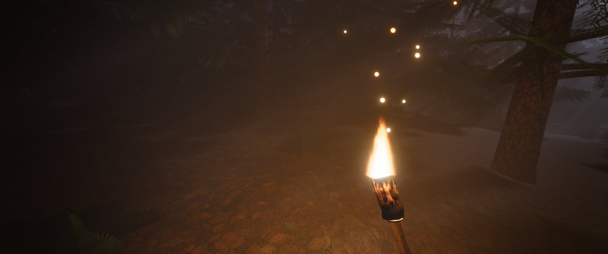

# Floresta noturna

Uma floresta à noite para andar em primeira pessoa com uma tocha na mão. Não tem objetivo: é para ver os gráficos.

## Como abrir

Dois cliques no `abrir.bat`. Ele sobe um servidor na porta 4352 e abre o navegador. Clique em **Entrar na mata**: o jogo vai para tela cheia e prende o mouse e o teclado.

| Tecla | Faz |
|---|---|
| W A S D | andar |
| Ctrl | correr |
| Espaço | pular |
| Shift | agachar |
| Esc | sair (com o teclado preso, segure o Esc se o navegador pedir) |

O jogo precisa da tela cheia porque, fora dela, o navegador não deixa a página ficar com o Ctrl, e Ctrl+W fecharia a aba. Se o navegador não prender o teclado, aparece um aviso no topo.

`http://127.0.0.1:4352/?qps` mostra os quadros por segundo no canto.

## O que tem

- Pinhal gerado por código: pinheiros e pinheirinhos com galhos em andares e placas de agulha que mexem com o vento.
- Raios de lua de verdade: a névoa é iluminada pelo mapa de sombra da lua, então os feixes aparecem para onde você olhar.
- Tocha com chama, fagulhas, fumaça e luz que tremula e projeta sombra dos troncos.
- Chão de agulhas e folhas secas, musgo, samambaias, grama, pedras e troncos caídos.
- Tudo é gerado na hora em menos de 2 segundos: nenhuma imagem é baixada.

Feito com [three.js](https://threejs.org) r185 (em `vendor/`, com a licença MIT dele). Licença deste projeto: MIT, no arquivo `LICENSE`.
